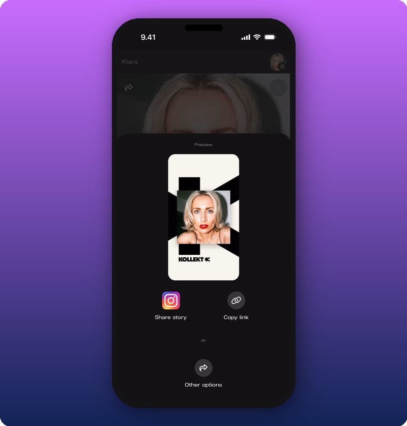
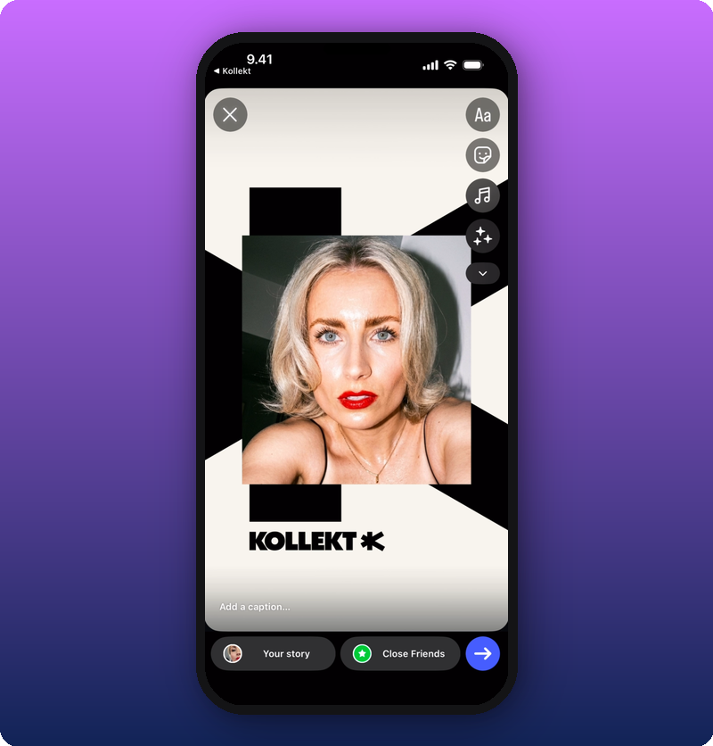
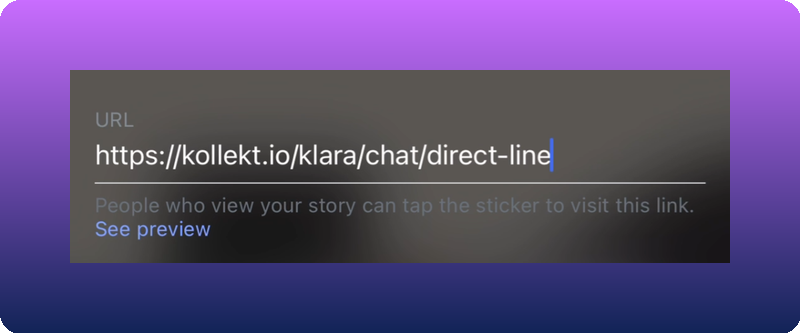
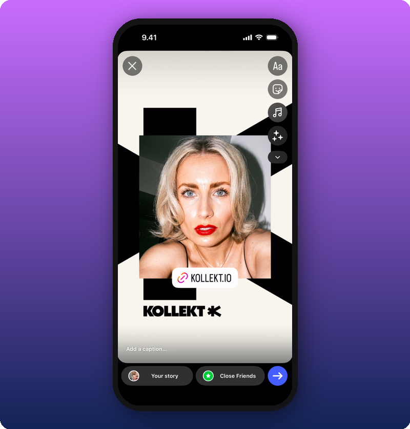

<Info>
  **Share story** is in the Kollekt app. On app.kollekt.io you can still copy your link and add it to any story yourself.
</Info>

## Four steps to a story

### 1. Copy your link

On your Kollekt, tap the share button in the top left of your Home. Under **Link to**, pick where the link opens: **Home**, **Direct Line** or **Chats**. Then tap **Copy link**.

Copying first means the link is ready to paste in Instagram.

### 2. Tap Share story

On the same sheet, tap **Share story**. Instagram opens with your Kollekt's picture ready as a story.

### 3. Add the link sticker

Tap the **sticker icon** in Instagram, choose **Link**, and paste your Kollekt link.

<Tip>
On some phones, the link disappears from the clipboard when you switch to Instagram. Going back to Kollekt and tapping **Copy link** again usually fixes it.
</Tip>

### 4. Post it

Move the sticker where it fits, then tap **Your story**.

## Words for the story

A line on top of the picture gives people a reason to tap. Some ideas to borrow or change:

- "New track on the Direct Line → tap to hear it first."
- "Voice note about [thing] on my Kollekt."
- "Everything I post before anywhere else → tap."
- "If you want the good stuff first, my Kollekt is here."
- "Behind the scenes from today → on Kollekt."

The first story about Kollekt can say a little more: what it is, and why you're inviting people. [Announce Kollekt to your audience](/for-artists/bring-fans-in/announce-to-your-fans) has more ideas.

## A few more ideas

- **A reason for each story.** After the first announcement, something specific, like a new Direct Line post, a subscriber-only post or a new drop, gives people more to tap for.
- **Timing.** A story stays up for 24 hours, so posting when your followers are usually around helps more people see it.
- **Your own look.** Any picture or video works as the background. The link sticker works the same on all of them.

## Related

- [Share your Kollekt link](/for-artists/bring-fans-in/sharing-your-page)
- [Add Kollekt to your social bios](/for-artists/bring-fans-in/social-bios)
- [Announce Kollekt to your audience](/for-artists/bring-fans-in/announce-to-your-fans)
