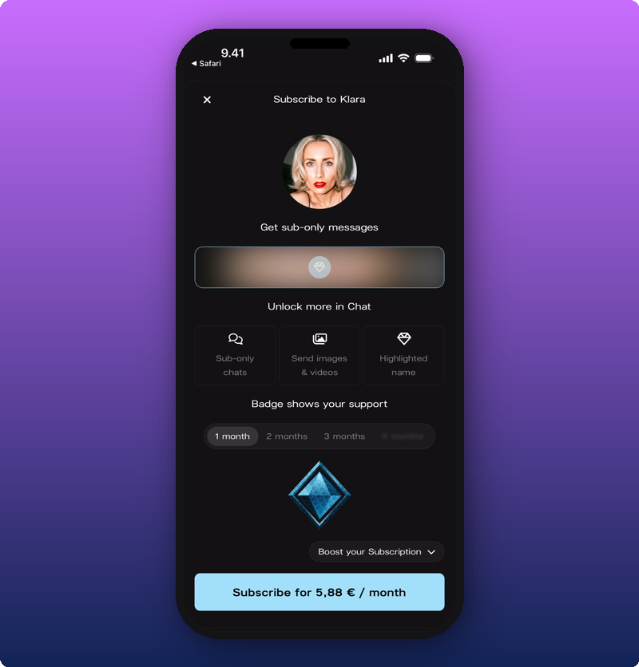

Joining your Kollekt is free, and any member can subscribe at any time. Subscriptions are open from the moment your Kollekt is claimed, with nothing to set up. It's a way for the people who care most to support you every month, and get a little more in return.

## What subscribers get

This is what a member sees when they're about to subscribe. The perks are built in, so there's nothing extra you have to create.

- **Subscriber-only posts** on your Direct Line. See [Subscriber-only posts](/for-artists/your-space/post-subscriber-only-content).
- **The Subscribers Chat,** a chat only subscribers see.
- **Photos and videos in chat.** Subscribers can send them, other members can't.
- **A highlighted name and a subscriber badge** in chat. The badge grows the longer someone stays subscribed.

Members without a subscription see some of this from the outside: locked posts on the Direct Line, and highlighted names in Main Chat.

## What members pay

| Where the member subscribes | Price |
| --- | --- |
| Browser (app.kollekt.io) | 4,99 € / month |
| Android app | 4,99 € / month |
| iPhone app | 5,88 € / month |

Prices include VAT. In the iPhone app, the higher price covers Apple's App Store fee, so your earnings are about the same wherever someone subscribes.

Subscriptions are pay what you want: members can choose to pay more than the minimum, and everyone gets the same perks whatever they pay. The price is the same for every artist, and a subscription renews every month until it's cancelled. Members can also give a subscription to someone else as a gift.

## Your share

Kollekt keeps a **20 % commission**, counted after VAT and payment fees. The rest is yours, or your team's if you share earnings. Kollekt takes **0 %** of what you sell through your own links, like your shop or ticket links.

[Step-by-step: How do subscriptions and earnings work?](https://help.kollekt.io/en/article/how-do-subscriptions-and-earnings-work-1s399xv/) has a worked example with real numbers.

## How the money reaches you

1. **A member subscribes** and pays every month.
2. **Your earnings add up.** Your [Stats](/for-artists/earn/see-your-stats-and-revenue) show what members have paid.
3. **Earnings are split, if you share them.** The owner sets up the split. See [Add team members and split revenue](/for-artists/earn/team-members-and-revenue-splits).
4. **Payouts go to your bank at the start of each month.** Everyone in the split sets up payouts once, in their own profile. Earnings wait until payouts are set up, and amounts under 5 € roll over to the next month. See [Connect your payout account](/for-artists/earn/connect-your-payout-account).

## Making subscriptions feel worth it

There's no right moment to start talking about subscriptions, and every artist does it differently. Some ideas:

- **Subscriber posts now and then,** like a demo, a presale link or a voice note. A locked post on the Direct Line also shows members what subscribing gives them.
- **Showing up in the Subscribers Chat,** even briefly, so subscribers feel there's a real person there.
- **A steady Direct Line and a lively Main Chat.** When members already enjoy being there, subscribing feels like a natural next step, not a sales pitch.

## Related

- [See your stats and revenue](/for-artists/earn/see-your-stats-and-revenue)
- [Connect your payout account](/for-artists/earn/connect-your-payout-account)
- [Add team members and split revenue](/for-artists/earn/team-members-and-revenue-splits)
- [Subscriber-only posts](/for-artists/your-space/post-subscriber-only-content)
